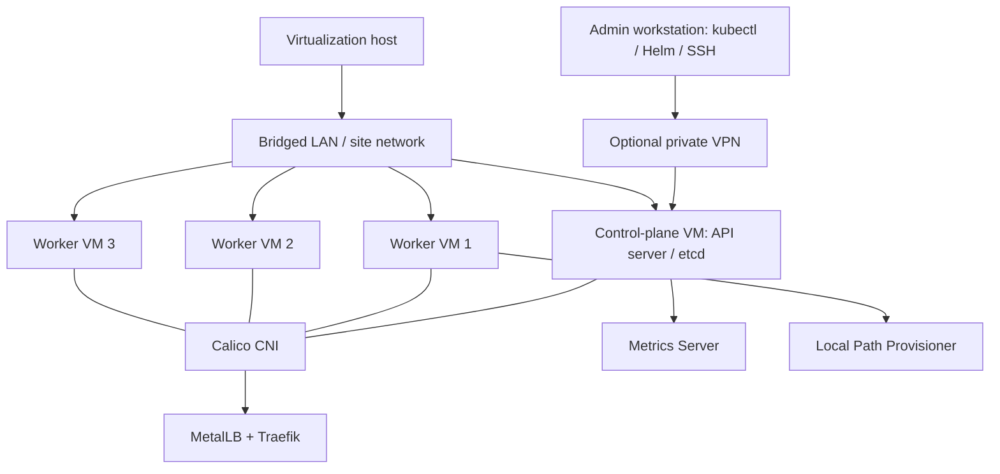

# On-Premises Kubernetes Cluster Build Runbook

A **public-safe**, reproducible Kubernetes homelab deployment guide based on a four-node Ubuntu/VMware `kubeadm` lab. It covers infrastructure planning through the verified persistent-volume test.

> **Public repository:** All site-specific addresses, hostnames, usernames, VPN endpoints, gateway values, credentials, and tokens have been replaced by variables or generic examples. This repository does **not** include the original PDF because it contains private homelab addressing.

## Architecture

**Deployment stages:** [01 Plan](docs/01-plan.md) → [02 Prepare Linux](docs/02-linux.md) → [03 Runtime](docs/03-runtime.md) → [04 kubeadm](docs/04-kubeadm.md) → [05 Calico](docs/05-calico.md) → [06 Networking & remote access](docs/06-access.md) → [07 MetalLB & Traefik](docs/07-ingress.md) → [08 Metrics](docs/08-metrics.md) → [09 Storage](docs/09-storage.md) → [10 Operations](docs/10-operations.md).

## Safe setup

1. Copy `.env.example` to `.env.local` and fill in **your own environment**. `.env.local` is ignored by Git.
2. Read each stage before running commands. All examples assume Ubuntu 24.04 and a compatible Kubernetes minor release.
3. Keep administrative kubeconfig, certificates, join tokens, and actual environment-specific manifests **outside Git**.
4. Run `bash scripts/check-public-safe.sh` before staging files; inspect `git diff --cached` before pushing.
5. Pin and validate versions before installation; verify official manifests and image compatibility.

### What this repository does not include
- kubeconfig or `/etc/kubernetes/pki` files
- actual `kubeadm join` tokens or CA hashes
- real LAN, Tailscale, public IPs or personal usernames
- actual SSH keys, credentials, DNS names or secrets
- the original runbook PDF (it contains real homelab values)

### Scope and security limits
This is a **single-control-plane educational lab**, not a production HA architecture. Local-path PVs are node-local, and the optional `--kubelet-insecure-tls` Metrics Server flag is documented as a **lab-only** workaround. See [production hardening](docs/10-operations.md).

**Status:** Verified through Local Path Provisioner and PVC persistence/cleanup. Prometheus, Grafana, Alertmanager and Argo CD are **not** part of the completed build.
